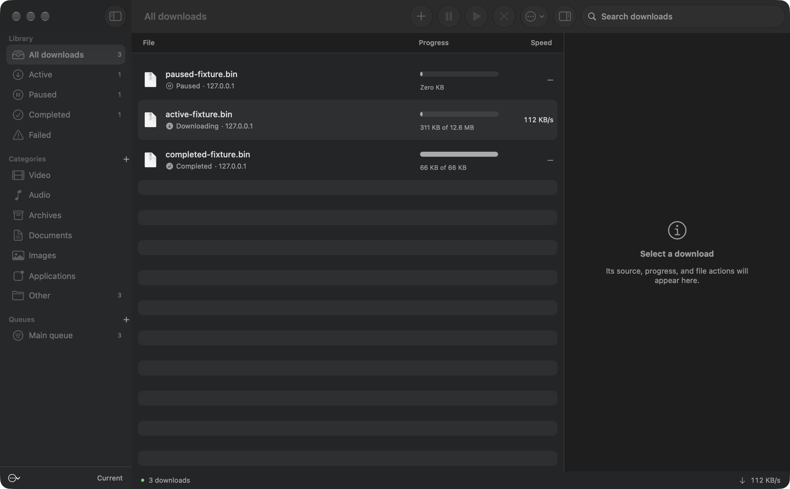

# Current

A native macOS download manager with segmented transfers, resumable queues, media downloads, and Chrome/Firefox integration. Built in SwiftUI, with aria2 for file transfers and yt-dlp/FFmpeg for supported media.

Current is an original open source application inspired by IDM's publicly documented workflows. It is independent of Tonec and Internet Download Manager; no IDM code, installer, branding, or artwork is distributed. It does not claim complete IDM parity.



## Install

Download the app and extension archives from [Releases](https://github.com/PDGamerSG/current-download-manager/releases).

The prebuilt **0.1.0 app requires Apple silicon and macOS 27 or later** because its bundled Homebrew libraries were built for that OS. Intel and older macOS releases are not verified. The Swift package targets macOS 13 for source builds with compatible dependencies.

1. Extract the macOS ZIP and move **Current.app** into `/Applications` or `~/Applications`.
2. Open Current. This release is ad hoc signed, without Developer ID signing or Apple notarization. If macOS blocks it, review the source/release and use **System Settings → Privacy & Security → Open Anyway**.
3. Open **Browser integration** in the app and install the browser connection. Keep the app at its permanent location afterwards.
4. For Chrome/Chromium, open `chrome://extensions`, enable **Developer mode**, then **Load unpacked** using the Chromium extension directory. The files are also inside the app's browser setup sheet.
5. For Firefox, open `about:debugging#/runtime/this-firefox`, choose **Load Temporary Add-on**, and select the Firefox directory's `manifest.json`. Temporary loading lasts until Firefox closes; permanent Firefox installation requires Mozilla signing.

The app includes aria2, yt-dlp, FFmpeg and their required libraries. Node, Python and Homebrew are development tools and are not required to use the app. Browser extensions are local development packages, not store listings. See [extension installation and privacy](extensions/README.md).

## Features

- Multi-connection HTTP/HTTPS, FTP and SFTP transfers; pause/resume, retry, crash recovery, mirror URLs and checksums.
- Batch input, history, refresh an expired URL, safe filenames, categories/folders, Finder actions, and redacted JSON import/export.
- Queue concurrency, priority, one-time/daily schedules, per-job/global bandwidth limits and an hourly quota. The app or CLI service must remain running for scheduled work.
- Basic credentials, destination-scoped browser cookies/referer and a file-transfer proxy. Private per-user state, authenticated loopback control, quarantine and an optional scanner executable.
- Direct media files, clear HLS/DASH and websites supported by yt-dlp; separate audio/video merging with FFmpeg.
- Bounded same-origin website link discovery with preview before adding files.
- Chrome/Firefox popup, context menus, selected/page links, media discovery and opt-in browser download capture. A browser transfer is cancelled only after Current acknowledges acceptance.
- Native macOS sidebar, inspector, search, keyboard shortcuts, drag/drop, opt-in clipboard offers and completion notifications.

[Feature and compatibility matrix](docs/FEATURES.md) distinguishes tested behavior, limitations and missing IDM features. DRM, Safari, POST-body replay and a full offline website mirror are outside this release.

## Build and test

Requires macOS, Swift 5.9+, Command Line Tools or Xcode, Node 20+, Python 3, and the download tools:

```sh
brew install aria2 ffmpeg yt-dlp
swift build --build-system native --product Current
swift build --build-system native --product currentctl
.build/debug/Current
```

Run the real-engine acceptance suite:

```sh
scripts/test.sh
```

For FTP/SFTP and real Chromium/Firefox checks:

```sh
python3 -m venv .artifacts/test-env
.artifacts/test-env/bin/pip install -r requirements-test.txt
npm ci
npx playwright install chromium firefox
PATH="$PWD/.artifacts/test-env/bin:$PATH" scripts/test.sh --protocols --browsers
```

These tests use temporary state and local servers, independently verify downloaded bytes, and restore native messaging manifests. Do not run the two browser suites concurrently. [Testing details and recorded evidence](docs/TESTING.md) describe the verification boundaries.

Create a redistributable app and its corresponding dependency sources:

```sh
scripts/build-app.sh
python3 scripts/fetch-third-party-sources.py dist/Current.app
```

Packaging downloads the pinned upstream standalone yt-dlp release through `gh`, bundles the installed aria2/FFmpeg dependency graph, rewrites dylib paths, includes notices and ad hoc signs the app. The source packager uses the exact installed recipes and pinned Git revisions, verifies upstream checksums, and excludes unrelated cache entries. Distribute the corresponding source archive with the binary release. [Third-party notices](THIRD_PARTY_NOTICES.md) explain the licenses.

## CLI

```sh
.build/debug/currentctl serve
# In another terminal:
.build/debug/currentctl add https://example.org/file.zip
.build/debug/currentctl list
.build/debug/currentctl request '{"action":"pause","ids":["job-id"]}'
```

The packaged CLI is `Current.app/Contents/MacOS/currentctl`. Use `CURRENT_STATE_DIR` to isolate a development service. Normal state is private to your macOS account at `~/Library/Application Support/Current`; sensitive cookies and URLs remain there and are stripped from exports. Do not share that directory.

GPL-3.0-or-later. Contributions and reproducible bug reports are welcome.
